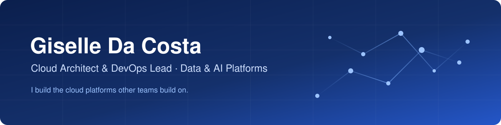
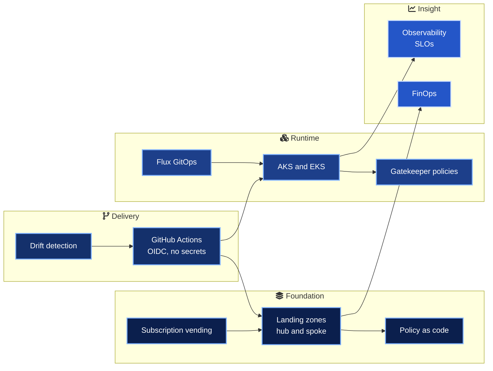
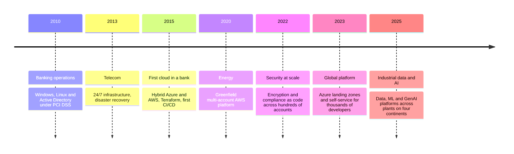

  

## In numbers

| 15+ | 14 | 7 | 4 |
| :---: | :---: | :---: | :---: |
| years in infrastructure and cloud | public platform repositories | core cloud and Kubernetes certifications | working languages |

## What I do

I build the cloud platforms other teams build on. Landing zones, Terraform modules, GitOps pipelines and Kubernetes platforms that are secure by default and quiet to operate. My work sits where infrastructure, data and AI meet, in industries where reliability and compliance are not optional.

## The platform, end to end

## Repositories

| Repository | What it shows | Stack |
| --- | --- | --- |
| [secure-genai-platform-azure](https://github.com/marlyngiselle/secure-genai-platform-azure) | Enterprise GenAI on Azure behind a private AI gateway: token quotas, managed identity, content safety and full traceability |   |
| [databricks-lakehouse-terraform](https://github.com/marlyngiselle/databricks-lakehouse-terraform) | A governed lakehouse: VNet-injected Databricks, Unity Catalog per environment, medallion pipelines shipped as bundles |   |
| [fabric-realtime-intelligence](https://github.com/marlyngiselle/fabric-realtime-intelligence) | Real-time industrial telemetry on Microsoft Fabric: Event Hubs, Eventhouse and KQL with anomaly detection, health scores and alert rules |   |
| [databricks-fabric-lakehouse-bridge](https://github.com/marlyngiselle/databricks-fabric-lakehouse-bridge) | Databricks produces, Fabric consumes: Unity Catalog gold tables exposed through OneLake, governed by data contracts with a breaking-change gate in CI |   |
| [enterprise-rag-platform](https://github.com/marlyngiselle/enterprise-rag-platform) | Retrieval-augmented generation the enterprise way: hybrid search with document-level security, grounded answers with citations and an evaluation gate |   |
| [mlops-predictive-maintenance](https://github.com/marlyngiselle/mlops-predictive-maintenance) | From notebook to governed production: MLflow on Databricks, Unity Catalog registry, a champion and challenger gate, Azure ML serving and drift monitoring |   |
| [governed-mcp-gateway](https://github.com/marlyngiselle/governed-mcp-gateway) | Safe, governed access for AI assistants to operations tools: role policies, JWT auth, redaction, rate limits and audit logging on MCP |   |
| [azure-landing-zone-terraform](https://github.com/marlyngiselle/azure-landing-zone-terraform) | A modular Azure landing zone with hub-and-spoke networking, policy as code and self-service subscription vending |   |
| [aks-gitops-platform](https://github.com/marlyngiselle/aks-gitops-platform) | An AKS platform run by Flux: ingress, certificates, observability, Gatekeeper policies and namespace-as-a-service |   |
| [terraform-github-actions-oidc](https://github.com/marlyngiselle/terraform-github-actions-oidc) | Reusable plan, apply and drift-detection workflows for Azure and AWS, with OIDC and no long-lived secrets |   |
| [secure-supply-chain](https://github.com/marlyngiselle/secure-supply-chain) | Signed, scanned and attested containers from commit to cluster, with admission policies that reject anything unverified |   |
| [slo-observability-kit](https://github.com/marlyngiselle/slo-observability-kit) | SLOs as code that generate multi-window burn-rate alerts, Grafana dashboards and error-budget policies |   |
| [cloud-finops-toolkit](https://github.com/marlyngiselle/cloud-finops-toolkit) | A tested Python CLI that finds cloud waste: idle resources, tag gaps, rightsizing and shutdown schedules |   |
| [platform-ops-toolkit](https://github.com/marlyngiselle/platform-ops-toolkit) | Day-to-day operations in Bash and PowerShell, safe by default, tested and documented |   |

## Fifteen years, one direction

## How I work

| Principle | In practice |
| --- | --- |
| Secure by default | Workload identity instead of secrets, private networking, policy enforced by the platform |
| Everything as code | If it can't be reviewed in a pull request, it isn't done |
| Self-service | The best platform request is the one nobody has to open |
| Cost is a feature | Tagging, rightsizing and schedules are designed in, not bolted on |
| Written first | Decision records and runbooks so the next engineer moves fast |

## Certifications

 

[LinkedIn](https://www.linkedin.com/in/giselledacosta) · French · English · Spanish · Portuguese

